### Hi there 👋

I'm Zhongying, a Postdoctoral Associate in Prof. Sherrie Wang's Earth Intelligence Lab at MIT (Mechanical Engineering). I build geospatial AI for Earth observation and environmental health: spatiotemporal deep learning, location encoders, soil organic carbon mapping, and high-resolution air pollution estimation. I did my PhD in Geography at CU Boulder with Prof. Morteza Karimzadeh at the GeoHAI Lab.

- 🌐 Website: [invictusying.github.io](https://invictusying.github.io/)
- 📚 Google Scholar: [Zhongying Wang](https://scholar.google.com/citations?user=AIE3aVIAAAAJ)
- 💼 LinkedIn: [stephen-zhongying-wang](https://www.linkedin.com/in/stephen-zhongying-wang-a02377158/)
- 👯 Open to collaborations on GeoAI, location encoders, and Earth observation

<!--
**InvictusYing/InvictusYing** is a ✨ _special_ ✨ repository because its `README.md` (this file) appears on your GitHub profile.

Here are some ideas to get you started:

- 🔭 I’m currently working on ...
- 🌱 I’m currently learning ...
- 👯 I’m looking to collaborate on ...
- 🤔 I’m looking for help with ...
- 💬 Ask me about ...
- 📫 How to reach me: ...
- 😄 Pronouns: ...
- ⚡ Fun fact: ...
-->

<!-- 
 -->

<!--

-->

  
  

